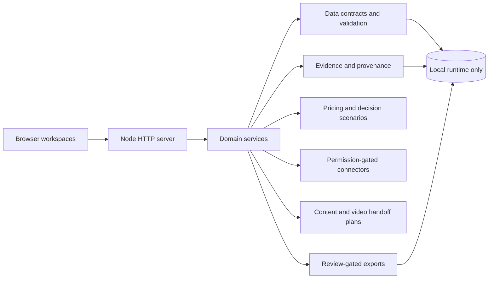
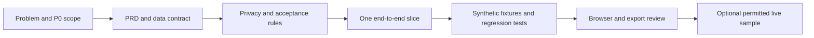

# E-commerce Content and Operations Assistant

Local-first, review-first tooling for turning product facts into market research, pricing scenarios, channel decisions, and content drafts.

This repository is a **public code and architecture release**. It contains implementation, documentation, and synthetic tests only. It does not contain reports, supplier files, PDFs, merchant-backend records, personal information, API keys, or real profitability conclusions.

## What the project is designed to do

The product follows one controlled workflow:

1. Capture a product brief or import permitted source material.
2. Normalize product, SKU, configuration, market, and evidence records.
3. Ask the user to confirm identity, cost, currency, unit, and commercial terms.
4. Collect or enter public market observations with source URLs and observation times.
5. Compare only evidence-backed configurations and calculate explicit cost scenarios.
6. Draft channel-specific text, images, or video handoff plans from confirmed facts.
7. Apply privacy, provenance, and independent-review gates before export.

The application must distinguish observed facts, user-confirmed inputs, assumptions, estimates, and model inferences. Missing logistics, platform fees, advertising, returns, or sales feedback remain unknown; the system must not convert assumptions into actual profit.

## Architecture



| Area | Responsibility |
| --- | --- |
| `server.js` | Local HTTP server, static pages, request validation, and API routing |
| `public/` | Research, intelligence, content, video, and task-center workspaces |
| `lib/` | Parsing, pricing, evidence, privacy, providers, workflows, and export services |
| `lib/commerce/` | Scoped projects, passports/SKUs, source contracts, task runs, budgets, idempotency, and review gates |
| `scripts/commerce/` | Local indexing, import, backup, and worker entry points; runtime outputs stay ignored |
| `test/` | `node:test` coverage using synthetic fixtures and temporary directories |
| `docs/` | Scope, integration boundaries, and release documentation |

The default server is local-only. Optional model and public-page research calls happen only when the user invokes the related workflow and configures them locally. The video workspace currently creates a handoff package; it does not claim to render a finished video.

## PRD-to-code process

The project uses a small vertical-slice process rather than starting with RAG or multi-agent orchestration:



Each PRD should define:

- user outcome and explicit non-goals;
- input fields, units, currency, source, time, confidence, and confirmation status;
- state transitions and failure behavior;
- privacy, permission, budget, and external-call boundaries;
- acceptance evidence, including negative cases and re-open/read-back checks;
- what is implemented, fixture-tested, live-sampled, or still blocked.

See [PRD workflow and acceptance rules](docs/PRD-WORKFLOW.md) and [video workbench boundaries](docs/VIDEO-WORKBENCH.md).

## Future merchant-backend data entry

Real logistics, platform fees, advertising, returns, sales feedback, and profit are intentionally not included in this repository. The planned integration is a user-controlled browser workflow:

1. The user opens and authenticates the merchant-backend window.
2. The assistant fills only an explicitly approved field set.
3. The user reviews and performs the final submit or confirmation.
4. The local system records field name, value, unit, currency, source page, observation time, operation ID, and confirmation status.
5. Corrections create a new version; historical entries are not silently overwritten.

Credentials, cookies, API keys, raw backend exports, and personal information remain outside Git and outside public exports. No unattended login, submission, or external message is part of the current public release. This integration is an architecture boundary, not a completed live connector.

## Privacy and publication boundary

Do not commit or push:

- generated reports, Excel/CSV exports, screenshots, media, or runtime databases;
- uploaded PDFs, supplier catalogs, merchant-backend input, real SKU/cost/quote data, or private evidence;
- personal information, cookies, credentials, API keys, tokens, or provider responses containing them;
- data-bearing JSON/JSONL snapshots or local run records.

The repository ignores local runtime and evidence paths, data-bearing files, environment files, and private documentation. `package.json` and `package-lock.json` are dependency metadata and are intentionally retained. Review the staged file list before every push:

```sh
git diff --cached --name-status
git diff --cached --check
```

## Run locally

Requirements: Node.js 18 or later.

```sh
npm install
npm start
```

Open <http://127.0.0.1:5178>.

For optional model-backed operations, copy `.env.example` to `.env.deepseek.local` and set a local key. The local file is ignored and must never be committed. Run the test suite with:

```sh
npm test
```

## Current limitations

- No live merchant-backend connector is enabled.
- No real logistics, platform-fee, advertising, return, or sales-feedback dataset is bundled.
- A pricing result is a scenario until all required inputs are confirmed; it is not an actual profit statement.
- Public research connectors require source, permission, rate-limit, and observation-time checks.
- Video generation, automatic transcription, and final media rendering are not connected.
- The legacy static report route is intentionally unconfigured and returns `pipeline_not_configured`; generic report jobs write only task-local workbooks after confirmation and audit.

## License

See [LICENSE](LICENSE).
